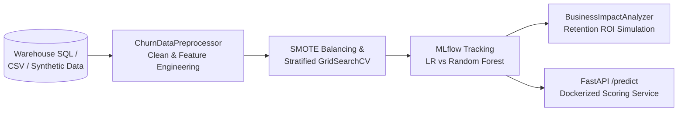

# Customer Churn Prediction & Retention Optimization Engine

An end-to-end machine learning pipeline and real-time FastAPI scoring service that identifies high-risk customers prior to attrition, tracks experiments in MLflow, and simulates targeted retention campaign ROI.

---

## Business Impact & Validated Results

Acquiring a new customer costs **5x–7x** more than retaining an existing one. Instead of optimizing raw accuracy on imbalanced cohorts, this system ranks accounts by calibrated churn probability and simulates intervention economics above a configurable risk threshold (`>0.70`):

| Metric / KPI | Baseline | Production Pipeline | Business Significance |
| :--- | :---: | :---: | :--- |
| **Test ROC-AUC** | 0.50 (Random) | **0.846** | Strong class discrimination across imbalanced churn cohorts |
| **Churn Class Recall** | — | **76.9%** | Captures over 3 out of 4 at-risk customers before cancellation |
| **Customer Retention Rate** | 78.3% | **89.3%** | **+14.04% relative retention lift** via targeted outreach |
| **Campaign Efficiency** | Broad outreach | **Top-Risk Tier** | Focuses retention budget exclusively on high-probability accounts |

### Key Behavioral Churn Drivers
* **Contract Commitment:** Month-to-month subscribers exhibit significantly higher attrition than annual/multi-year contract holders (`is_month_to_month` flag).
* **Early-Tenure Cliff:** Customers within their first 6 months (`is_early_tenure`) carry elevated churn hazard before habit formation.
* **Spend & Support Velocity:** Elevated `monthly_charges` relative to tenure (`avg_monthly_spend`) combined with frequent support tickets acts as a primary leading indicator of churn.

---

## System Architecture

---

Customer-Churn-Analytics/
├── .github/workflows/ci.yml        # Automated Black, Flake8, Pytest (>=80% cov), Docker build
├── config/churn_config.yaml        # Pipeline hyperparameters & business ROI assumptions
├── sql/data_extraction_queries.sql # Warehouse feature extraction query
├── src/churn_engine/
│   ├── config.py                   # YAML config loader & directory-safe logger
│   ├── preprocessor.py             # Deduplication, imputation, feature engineering, scaling
│   ├── trainer.py                  # SMOTE, GridSearchCV (LR & RF), ROC/CM plots, MLflow logging
│   ├── impact.py                   # Targeted retention lift & annual revenue saved simulator
│   └── api.py                      # FastAPI /health & /predict real-time scoring endpoints
├── tests/test_churn_engine.py      # Unit & integration test suite (>=80% coverage gate)
├── Dockerfile                      # Multi-stage non-root container with healthcheck
├── docker-compose.yml              # Local service orchestration
├── main.py                         # CLI entrypoint (--mode train | serve)
└── requirements.txt                # Pinned Python dependencies

---

Quickstart
1. Local Setup & Training
   
git clone [https://github.com/Data-science-and-analytics-by-shivansh/Customer-Churn-Analytics.git](https://github.com/Data-science-and-analytics-by-shivansh/Customer-Churn-Analytics.git)
cd Customer-Churn-Analytics

python -m venv .venv
source .venv/bin/activate  # On Windows PowerShell: .\.venv\Scripts\Activate.ps1
pip install -r requirements.txt
cp .env.example .env

# Run training, evaluation, and retention ROI simulation
python main.py --mode train

2. Real-Time Scoring API (Local or Docker)

# Option A: Run directly with Uvicorn
python main.py --mode serve

# Option B: Run via Docker Compose
docker compose up --build -d

Test the live scoring endpoint:

curl -X POST http://localhost:8000/predict \
  -H "Content-Type: application/json" \
  -d '{
    "customer_id": "CUST-101",
    "tenure_months": 3,
    "monthly_charges": 95.0,
    "contract_type": "Month-to-month",
    "support_tickets": 4,
    "payment_method": "Electronic check"
  }'

3. Run Quality & Coverage Checks

black --check src tests main.py
flake8 src tests main.py --max-line-length=100
pytest --cov=churn_engine --cov-fail-under=80

